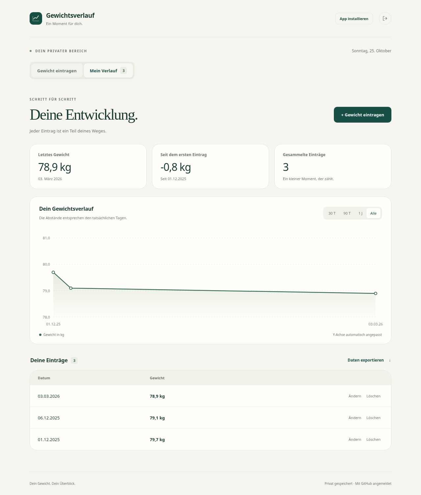

# Gewichtsverlauf

Private, installierbare Web-App für **rainermu85-blip**. Gewicht mit einer Nachkommastelle eintragen und anschließend die Entwicklung ansehen. Die Anmeldung erfolgt über GitHub. Nur die feste GitHub-ID `260273876` ist zugelassen.



## Funktionen

- Ein Gewicht pro Kalendertag, mit Komma oder Punkt; nach dem Speichern direkt zum Diagramm.
- Einträge nachtragen, ändern und nach Bestätigung löschen.
- Echte Zeitachse: fünf Tage Abstand sind fünf Tage, unabhängig von weiteren Einträgen. UTC-basierte Kalendertage verhindern Verzerrungen durch Sommerzeit.
- Automatische Y-Achse mit Rand und mindestens ungefähr 2 kg Spannweite, damit kleine Änderungen sichtbar bleiben, ohne sie übermäßig zu vergrößern.
- Ansicht für 30 Tage, 90 Tage, ein Jahr oder alle Einträge; Tabelle mit sämtlichen Daten, exakten Datum-/Gewicht-Tooltips und CSV-Export.
- PWA für Android/Chrome/Brave mit Manifest, Symbolen, Service Worker und Installieren-Schaltfläche. Der Browser steuert, ob ein automatischer Installationsdialog angeboten wird.
- Zentrale Speicherung in Cloudflare D1. Geräteübergreifend nach GitHub-Anmeldung verfügbar. Keine Gewichtsdaten in Browser-Caches oder `localStorage`.

## Online stellen

**Stand:** Der Code ist fertig und lokal geprüft. Eine produktive Instanz und eine GitHub-OAuth-App müssen mit dem Eigentümerkonto eingerichtet werden. GitHub Pages allein stellt dafür weder Backend noch privaten Zugriff bereit.

Voraussetzungen: [Cloudflare-Konto](https://dash.cloudflare.com/sign-up), GitHub-Konto, [Node.js 24 LTS](https://nodejs.org/). Cloudflare Workers und D1 sind für diese kleine persönliche App grundsätzlich innerhalb der Free-Tarif-Kontingente nutzbar; es wird kein kostenpflichtiger Tarif angelegt.

```sh
git clone https://github.com/rainermu85-blip/Gewichtsverlauf.git
cd Gewichtsverlauf
npm ci
npm run setup
```

Der Assistent führt durch Cloudflare-Anmeldung, Datenbank und Veröffentlichung. Danach öffnest du die ausgegebene GitHub-Adresse, registrierst dort die OAuth-App und übernimmst die **Client ID** in den Assistenten. Den **Client Secret** gibst du nur direkt im Cloudflare-Terminaldialog ein. Er landet weder im Repository noch im Browser-Code.

[Ausführliche und manuelle Einrichtung →](docs/EINRICHTUNG.md)

## Entwicklung und Prüfung

```sh
npm ci
npm run check
cp .dev.vars.example .dev.vars
# Eigene lokale GitHub-OAuth-App in .dev.vars konfigurieren.
npm run db:local
npm run dev
```

Lokal: `http://localhost:8787`; GitHub-Callback: `http://localhost:8787/auth/callback`. Die lokale Datenbank ist von der Produktionsdatenbank getrennt. Es gibt keinen Entwicklungsmodus, der die Anmeldung umgeht.

`npm run check` prüft Syntax, Fachlogik, SQL-basierte API-/OAuth-Tests und die Worker-Paketierung. GitHub Actions führt die Prüfungen bei Push und Pull Requests aus. Lokal wurden zusätzlich Chromium-Browsertests mit echten lokalen D1-Schreibzugriffen, Desktop-/Handyansicht, CSV-Download und Offline-Verhalten durchgeführt. Der echte GitHub-/Cloudflare-Login und der native Android-Installationsdialog bleiben bis zur Einrichtung auf den Zielkonten ungeprüft.

## Aufbau

| Verzeichnis | Aufgabe |
| --- | --- |
| `public/` | Deutsche Oberfläche, SVG-Diagramm, PWA und Symbole, ohne externe Schriftarten oder Skripte |
| `src/worker.js` | OAuth mit PKCE und State, serverseitige Kontoprüfung, Sitzungen und private API |
| `src/domain.js` | Gewichts- und Datumsvalidierung; Speicherung in exakten Zehntel-Kilogramm |
| `migrations/` | Datenbanktabellen für Einträge, Sitzungen und kurzlebige OAuth-Vorgänge |
| `scripts/setup.mjs` | Einmalige geführte Einrichtung im eigenen Cloudflare-Konto |
| `test/` | Automatisierte Tests mit der echten SQLite-Migration |

## Datenschutz und Betrieb

Die Login-Seite und allgemeine App-Dateien sind erreichbar. Die eigentliche App-Ansicht und **jede** API-Abfrage sind serverseitig auf dein Konto beschränkt. GitHub dient zur Identitätsprüfung; es werden keine Repository-Berechtigungen angefordert. Das GitHub-Zugriffstoken wird nach der Identitätsprüfung verworfen. Eine zufällige Sitzung wird per Secure-/HttpOnly-/SameSite-Cookie gehalten; die Datenbank speichert nur dessen Hash. Sitzungen laufen nach 30 Tagen ab. Schreibzugriffe benötigen zusätzlich CSRF-Token und passenden Origin.

Gewichtseinträge liegen in deiner Cloudflare-Datenbank; GitHub und Cloudflare bleiben die beteiligten Anbieter. Die Daten werden nicht als Dateien oder Commits ins Repository geschrieben. Für Datenzugriff und neue Einträge wird Internet benötigt. Offline zeigt die App nur eine neutrale Hinweisseite. Mit „Daten exportieren“ kannst du eine eigene CSV-Sicherung herunterladen. Zum sofortigen Sperren aller Sitzungen siehe die Einrichtungsanleitung.
